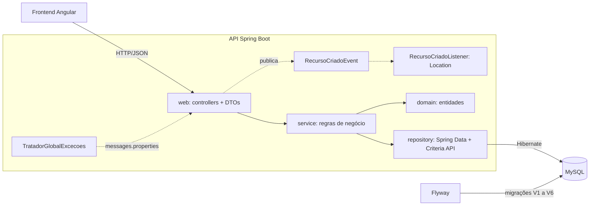
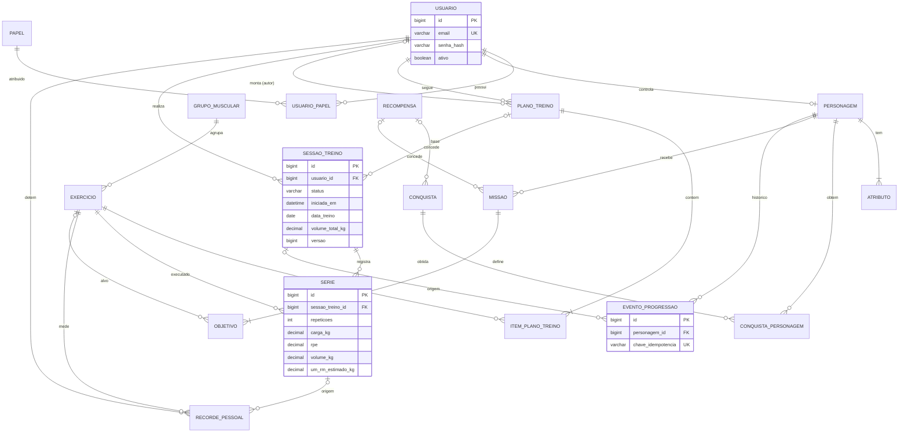

# IronQuest API

API REST do **IronQuest: RPG de progressão física baseado em treinos reais**.
Projeto final de Tecnologia em Desenvolvimento de Sistemas (UTFPR, Campus Santa Helena, 2º semestre de 2026).

Aluno: Vitor Eduardo de Lima Kenor (RA 2576791).

## Entregas

| Checkpoint | Conteúdo | Situação |
|---|---|---|
| 1. Arquitetura e banco de dados | Monólito modular, 15 entidades, migrações Flyway V1 a V5, cadastros base, Swagger | Entregue |
| 2. Funcionalidades | Tratamento de erros, Bean Validation, eventos, atualização parcial, relacionamentos, regras de negócio, filtro e paginação | Esta entrega |

Ficam para os próximos checkpoints:

- autenticação com JWT e aplicação do RBAC nos endpoints;
- motor de progressão (experiência, nível, atributos, conquistas e missões);
- frontend Angular.

## Checkpoint 2: funcionalidades

As aulas usam o domínio financeiro do curso (categorias, pessoas e lançamentos). No IronQuest, as mesmas técnicas foram aplicadas a:

| Curso | IronQuest |
|---|---|
| `Categoria` | `GrupoMuscular` |
| `Pessoa` (com `ativo`) | `Usuario` (com `ativo`) |
| `Lancamento` | `SessaoTreino` e suas `Serie`s |
| `dataVencimento` (`LocalDate`) | `dataTreino` (`LocalDate`) |
| `LancamentoFilter` | `SessaoTreinoFilter` |
| `LancamentoRepositoryQuery` / `LancamentoRepositoryImpl` | `SessaoTreinoRepositoryQuery` / `SessaoTreinoRepositoryImpl` |
| `PessoaInexistenteOuInativaException` | `UsuarioInativoException` |
| `RecursoCriadoEvent` / `RecursoCriadoListener` | mesmos nomes, em `shared/event` |
| `AlgamoneyExceptionHandler` | `TratadorGlobalExcecoes` |

### Aula por aula

A coluna "Postman" indica a pasta da coleção [IronQuest.postman_collection.json](postman/IronQuest.postman_collection.json) que demonstra a aula.

| Aula | Aplicação no IronQuest | Onde está | Postman |
|---|---|---|---|
| 01. Modelo, repositório e recursos | Entidade `GrupoMuscular`, `GrupoMuscularRepository` (Spring Data JPA) e controller REST. | `treino/domain`, `treino/repository`, `treino/web/CatalogoTreinoController` | Aula 01 |
| 02. Cadastrando nova categoria | `POST /api/grupos-musculares` responde 201 com o recurso criado e o cabeçalho `Location`. | `CatalogoTreinoController.criarGrupo` | Aula 02 |
| 03. Desafio: novos recursos | Cadastros de usuário (a "pessoa" do curso), personagem, exercício, plano, recompensa e conquista. | controllers de cada módulo | Aula 03 |
| 04. Atributos desconhecidos | `spring.jackson.deserialization.fail-on-unknown-properties: true`. Um atributo extra gera 400 com "O atributo 'x' não é reconhecido". | `application.yml`, `TratadorGlobalExcecoes.handleHttpMessageNotReadable` | Aula 04 |
| 05. Tratando erros com ExceptionHandler | `@RestControllerAdvice` que estende `ResponseEntityExceptionHandler`. Cada erro traz `mensagemUsuario` (do `messages.properties`) e `mensagemDesenvolvedor` (causa técnica). | `shared/web/TratadorGlobalExcecoes`, `shared/web/Erro`, `resources/messages.properties` | Aula 05 |
| 06. Bean Validation | `@Valid` nos DTOs de entrada. As mensagens e os rótulos dos campos vêm do `messages.properties` (ex.: "Nome é obrigatório(a)"). | `*/web/dto`, `messages.properties` | Aula 06 |
| 07. Controlando eventos | Todo POST que cria recurso publica `RecursoCriadoEvent`. O `RecursoCriadoListener` monta o `Location`, inclusive em rotas aninhadas (ex.: `/api/usuarios/1/personagem` gera `/api/personagens/3`). | `shared/event` | Aula 07 |
| 08. Desafio: atualizar e deletar | `PUT` e `DELETE` em todos os recursos. | controllers | Aula 08 |
| 08. Comentário 1: recurso não encontrado | `RecursoNaoEncontradoException` gera 404 com "Usuário de id 5 não encontrado(a)". | `shared/exception` | Aulas 01 e 08 |
| 08. Comentário 2: classe Service | Regras de negócio nas classes `*Service` (e-mail único, uma sessão em andamento, autor do plano). Os controllers só delegam. | `*/service` | Aula 08 |
| 09. Atualização parcial | `PUT /api/usuarios/{id}/ativo`, `/api/exercicios/{id}/ativo` e `/api/planos-treino/{id}/ativo`. O corpo é `true` ou `false` e a resposta é 204. | `UsuarioController`, `CatalogoTreinoController`, `PlanoTreinoController` | Aula 09 |
| 10. Relacionamento entre recursos | Plano → usuário, autor e exercícios; sessão → usuário e plano; série → sessão e exercício. As respostas trazem o recurso relacionado como `{ "id", "nome" }`. | entidades `@ManyToOne`/`@OneToMany`, `shared/web/dto/ReferenciaResponse` | Aula 10 |
| 11. Desafio: listar com relacionamentos e `LocalDate` | Nova coluna `data_treino` (`LocalDate`), calculada no fuso `America/Sao_Paulo`. A listagem de sessões traz usuário e plano relacionados. | `V6__adicionar_data_treino.sql`, `SessaoTreino`, `TempoConfig` | Aula 11 |
| 12. Validando inconsistências | Violação de restrição do banco (ex.: excluir exercício já usado em plano) gera 409 "Operação não permitida", com a causa SQL em `mensagemDesenvolvedor`. | `TratadorGlobalExcecoes.tratarIntegridade` | Aula 12 |
| 13. Desafio: Bean Validation nas classes | Todos os DTOs validados, incluindo itens aninhados do plano (`itens[0].seriesAlvo`) e o filtro de pesquisa (`@AssertTrue` no período). | `*/web/dto`, `SessaoTreinoFilter` | Aula 13 |
| 14. Regra: não salvar com pessoa inativa | `UsuarioInativoException` (422). Usuário inativo não inicia nem finaliza sessão, não registra nem corrige séries e não cria plano ou personagem. | `Usuario.exigirAtivo`, `SessaoTreino`, `UsuarioService.buscarAtivo` | Aula 14 |
| 15. Filtro na pesquisa | `GET /api/sessoes-treino` filtra por usuário, status, plano, exercício, período e texto. A consulta usa Criteria API com o metamodelo JPA (`SessaoTreino_`). | `treino/repository/filter`, `treino/repository/sessao` | Aula 15 |
| 16. Paginação | `Pageable` (`page`, `size`, `sort`) com resposta `PagedModel`. A ordenação só aceita `dataTreino`, `iniciadaEm` e `volumeTotalKg`. | `SessaoTreinoController.pesquisar`, `SessaoTreinoRepositoryImpl` | Aula 16 |

### Diferenças em relação ao curso

- **Envelope de erro:** os erros seguem a RFC 9457 (`application/problem+json`). A lista `erros` mantém `mensagemUsuario` e `mensagemDesenvolvedor`, como no curso.
- **DTOs:** requisições e respostas são records Java, e não as próprias entidades. Por isso a Bean Validation fica nos DTOs.
- **Códigos HTTP:** conflitos respondem 409 e regras de negócio respondem 422. O curso usa 400 para os dois.
- **Recurso inexistente:** no Spring Data 3 ou superior, `deleteById` não lança mais `EmptyResultDataAccessException`. Os services verificam a existência e lançam `RecursoNaoEncontradoException` (404).
- **Atualização:** em vez de `BeanUtils.copyProperties`, as entidades expõem métodos de domínio (`atualizar`, `definirAtivo`), que preservam as regras.
- **Detalhes técnicos:** `ironquest.erros.expor-detalhes=false` oculta `mensagemDesenvolvedor`. Use essa opção em produção.

## Tecnologias

| Camada | Tecnologia |
|---|---|
| Linguagem | Java 21 |
| Framework | Spring Boot 4.1 (Web MVC, Data JPA, Validation) |
| Persistência | Hibernate 7 (Criteria API e metamodelo JPA), MySQL 8.4, Flyway 12 |
| JSON | Jackson 3 |
| Senhas | BCrypt (`spring-security-crypto`) |
| Documentação | springdoc-openapi 3 (Swagger UI) |
| Testes | JUnit 5, MockMvc, Testcontainers (MySQL), Postman/Newman |

A proposta inicial citava PostgreSQL. O projeto usa MySQL, conforme a lista de softwares da disciplina.

## Arquitetura

A API é um **monólito modular**: um único deploy, dividido em módulos de domínio com as mesmas camadas.

```
br.edu.utfpr.ironquest
├── shared        EntidadeBase, exceções, tratador de erros, eventos, CORS, OpenAPI, relógio, BCrypt
│   ├── event         RecursoCriadoEvent, RecursoCriadoListener
│   ├── exception     IronQuestException e subclasses (404, 409, 422, 400)
│   └── web           TratadorGlobalExcecoes, Erro, ReferenciaResponse
├── usuario       Usuario, Papel, UsuarioInativoException
├── personagem    Personagem, Atributo, objetivos pessoais
├── treino        GrupoMuscular, Exercicio, PlanoTreino, SessaoTreino, Serie, RecordePessoal
│   └── repository
│       ├── filter    SessaoTreinoFilter
│       └── sessao    SessaoTreinoRepositoryQuery, SessaoTreinoRepositoryImpl (Criteria API)
└── progressao    Recompensa, Conquista, Missao, Objetivo, EventoProgressao

Cada módulo:
  domain/       entidades JPA e regras de domínio (ex.: SessaoTreino.finalizar)
  repository/   interfaces Spring Data JPA
  service/      casos de uso, transações e conversão para DTO
  web/          controllers REST e DTOs (records Java)
```



Regras de dependência:

- Os controllers só chamam services. Os services devolvem DTOs, nunca entidades (`open-in-view` desligado).
- Um módulo acessa outro pelo service público, e não pelo repositório do outro módulo.
- O esquema pertence ao Flyway. O Hibernate roda com `ddl-auto: validate` e a aplicação não sobe se o mapeamento divergir das tabelas.

## Formato dos erros

Todos os erros têm o mesmo formato. Exemplo de `POST /api/usuarios` com dados inválidos:

```json
{
  "title": "Dados inválidos",
  "status": 400,
  "detail": "Um ou mais campos são inválidos",
  "instance": "/api/usuarios",
  "erros": [
    {
      "campo": "email",
      "mensagemUsuario": "E-mail deve ser um e-mail válido",
      "mensagemDesenvolvedor": "Field error in object 'criarUsuarioRequest' on field 'email': rejected value [x]; ..."
    },
    { "campo": "nome", "mensagemUsuario": "Nome é obrigatório(a)", "mensagemDesenvolvedor": "..." }
  ]
}
```

| Situação | Status | Exemplo de `mensagemUsuario` |
|---|---|---|
| JSON malformado, corpo ausente, atributo desconhecido, valor fora do enum | 400 | O atributo 'apelido' não é reconhecido |
| Bean Validation | 400 | Senha deve ter entre 8 e 72 caracteres |
| Parâmetro com tipo errado, ordenação não permitida | 400 | Valor 'abc' inválido para o parâmetro 'id' |
| Recurso inexistente | 404 | Sessão de treino de id 9 não encontrado(a) |
| Duplicidade ou vínculo | 409 | Já existe um usuário com o e-mail ana@ironquest.dev |
| Restrição do banco violada | 409 | Operação não permitida: o registro está vinculado a outros dados... |
| Regra de negócio | 422 | O usuário 4 está inativo e não pode registrar treinos |

## Pesquisa de sessões (filtro e paginação)

`GET /api/sessoes-treino` e `GET /api/usuarios/{usuarioId}/sessoes-treino` aceitam os parâmetros abaixo, todos opcionais:

| Parâmetro | Exemplo | Efeito |
|---|---|---|
| `usuarioId` | `1` | Sessões do usuário |
| `status` | `FINALIZADA` | `EM_ANDAMENTO`, `FINALIZADA` ou `CANCELADA` |
| `planoTreinoId` | `2` | Sessões feitas com o plano |
| `exercicioId` | `11` | Sessões com ao menos uma série do exercício |
| `dataTreinoDe`, `dataTreinoAte` | `2026-09-01` | Período (inclusivo), no formato `yyyy-MM-dd` |
| `observacoes` | `pernas` | Trecho das observações, sem diferenciar maiúsculas |
| `page`, `size` | `0`, `10` | Página (começa em 0) e tamanho (padrão 10, máximo 50) |
| `sort` | `volumeTotalKg,desc` | `dataTreino`, `iniciadaEm` ou `volumeTotalKg`. Sem `sort`, os treinos mais recentes vêm primeiro. |

Exemplo: `GET /api/sessoes-treino?usuarioId=1&size=2`

```json
{
  "content": [
    {
      "id": 3,
      "usuario": { "id": 1, "nome": "Vitor Eduardo Kenor" },
      "planoTreino": null,
      "status": "CANCELADA",
      "dataTreino": "2026-09-30",
      "iniciadaEm": "2026-10-01T01:30:00Z",
      "finalizadaEm": null,
      "volumeTotalKg": 0.00
    }
  ],
  "page": { "size": 2, "number": 0, "totalElements": 3, "totalPages": 2 }
}
```

A sessão acima começou às 01:30 em UTC. No fuso de Brasília, isso ainda é 30/09, e por isso `dataTreino` é `2026-09-30`.

## Modelo de dados



| Migração | Conteúdo |
|---|---|
| `V1__criar_modulo_usuario` | `papel`, `usuario`, `usuario_papel` |
| `V2__criar_modulo_personagem` | `personagem`, `atributo` |
| `V3__criar_modulo_treino` | `grupo_muscular`, `exercicio`, `plano_treino`, `item_plano_treino`, `sessao_treino`, `serie`, `recorde_pessoal` |
| `V4__criar_modulo_progressao` | `recompensa`, `conquista`, `conquista_personagem`, `missao`, `objetivo`, `evento_progressao` |
| `V5__inserir_dados_iniciais` | 3 papéis, 10 grupos musculares, 17 exercícios, 5 recompensas e 5 conquistas |
| `V6__adicionar_data_treino` | Coluna `data_treino` (preenchida para sessões antigas) e índice `(usuario_id, data_treino)` |

Integridade garantida pelo banco:

- `UNIQUE` em `evento_progressao.chave_idempotencia` (premiação única) e em `conquista_personagem (personagem_id, conquista_id)`.
- Um personagem por usuário. Um recorde atual por usuário, exercício e tipo.
- `CHECK` para enums, RPE de 1 a 10, RIR de 0 a 10, repetições, carga e chefe das missões `CHEFE`.
- Chaves estrangeiras sem cascata nos catálogos: exercício usado em plano, série ou recorde não pode ser excluído (aula 12).
- `ON DELETE CASCADE` a partir do usuário: excluir a conta remove personagem, planos, sessões, séries, recordes e progressão.

## Regras de domínio

- **Volume da série:** `carga × repetições`.
- **1RM estimado (Epley):** `carga × (1 + repetições / 30)`. Com 1 repetição, o 1RM é a própria carga.
- **Volume da sessão:** soma das séries de `TRABALHO`. Séries de `AQUECIMENTO` não contam.
- **Recordes:** calculados na finalização da sessão (maior carga, maior 1RM estimado e maior volume em uma série).
- **Finalização idempotente:** reenviar a finalização devolve `jaEstavaFinalizada: true` sem recalcular nada.
- **Uma sessão em andamento por usuário.** Séries só podem ser registradas, corrigidas ou removidas em sessão `EM_ANDAMENTO`.
- **Sessão finalizada não pode ser excluída** (422). Sessões em andamento ou canceladas podem ser excluídas.
- **Usuário inativo não registra treinos** (422).
- **Exercício inativo** não entra em planos nem em séries novas, mas continua no histórico.

## Como executar

### Pré-requisitos

- JDK 21 (ex.: Eclipse Temurin 21);
- MySQL Community 8.x, ou Docker;
- Spring Tool Suite 4 ou mais recente (o STS 3 não suporta Java 21 nem Spring Boot 4);
- Postman.

### 1. Banco de dados

**Opção A: MySQL Community instalado.** A API cria o banco `ironquest` automaticamente. Informe usuário e senha com as variáveis `DB_USERNAME` e `DB_PASSWORD` (padrão `root`/`root`) ou edite `src/main/resources/application.yml`.

**Opção B: Docker.**

```bash
docker compose up -d
```

### 2. Rodar no Spring Tool Suite

1. Abra **File > Import > Maven > Existing Maven Projects** e selecione a pasta `ironquest-api`.
2. Confirme que o projeto usa o JDK 21 em **Project > Properties > Java Build Path**.
3. Clique com o botão direito em `IronQuestApplication` e escolha **Run As > Spring Boot App**.
4. Se a senha do MySQL não for `root`, defina `DB_PASSWORD` em **Run Configurations > Environment**.

Classes como `SessaoTreino_` são geradas na compilação pelo `hibernate-processor`. Se o STS indicar que elas não existem, clique com o botão direito no projeto e escolha **Maven > Update Project**.

### 3. Rodar pela linha de comando

```bash
./mvnw spring-boot:run        # Linux/macOS
mvnw.cmd spring-boot:run      # Windows
```

### 4. Endereços

- API: `http://localhost:8080/api`
- Swagger UI: `http://localhost:8080/swagger-ui.html`
- OpenAPI JSON: `http://localhost:8080/v3/api-docs`

## Endpoints

| Recurso | Endpoints |
|---|---|
| Papéis | `GET /api/papeis` |
| Usuários | `GET /api/usuarios?ativo=` · `POST /api/usuarios` · `GET, PUT, DELETE /api/usuarios/{id}` · `PUT /api/usuarios/{id}/ativo` |
| Personagem | `POST, GET /api/usuarios/{usuarioId}/personagem` · `GET, PUT /api/personagens/{id}` |
| Grupos musculares | `GET, POST /api/grupos-musculares` · `GET, PUT, DELETE /api/grupos-musculares/{id}` |
| Exercícios | `GET /api/exercicios?grupoMuscularId=&ativo=` · `POST /api/exercicios` · `GET, PUT, DELETE /api/exercicios/{id}` · `PUT /api/exercicios/{id}/ativo` |
| Planos de treino | `GET, POST /api/usuarios/{usuarioId}/planos-treino` · `GET, PUT, DELETE /api/planos-treino/{id}` · `PUT /api/planos-treino/{id}/ativo` |
| Sessões de treino | `GET /api/sessoes-treino` (filtro e paginação) · `GET, POST /api/usuarios/{usuarioId}/sessoes-treino` · `GET, DELETE /api/sessoes-treino/{id}` |
| Séries | `POST /api/sessoes-treino/{id}/series` · `GET, PUT, DELETE /api/sessoes-treino/{id}/series/{serieId}` |
| Ciclo da sessão | `POST /api/sessoes-treino/{id}/finalizar` · `POST /api/sessoes-treino/{id}/cancelar` |
| Recordes | `GET /api/usuarios/{usuarioId}/recordes?exercicioId=` |
| Recompensas | `GET, POST /api/recompensas` · `GET, PUT, DELETE /api/recompensas/{id}` |
| Conquistas | `GET, POST /api/conquistas` · `GET, PUT, DELETE /api/conquistas/{id}` |
| Jornada | `GET /api/personagens/{id}/missoes?status=` · `/conquistas` · `/eventos` |

## Testes

### Postman

1. Importe `postman/IronQuest.postman_collection.json`.
2. Com a API rodando, use **Run collection**.

A coleção tem 77 requisições em 17 pastas, uma por aula, executadas em ordem. As 146 asserções conferem status, mensagens, cabeçalho `Location`, filtros e paginação. A última pasta remove os dados criados, então a coleção pode ser executada várias vezes.

Pela linha de comando:

```bash
npx newman run postman/IronQuest.postman_collection.json
```

### JUnit

Os testes de integração precisam do Docker em execução (Testcontainers sobe um MySQL 8.4 descartável):

```bash
./mvnw test
```

| Classe | O que verifica |
|---|---|
| `CalculadoraDesempenhoTest` | Fórmulas de volume e 1RM |
| `FluxoTreinoIntegrationTest` | Fluxo completo: cadastro, sessão, séries, finalização idempotente e recordes |
| `TratamentoErrosIntegrationTest` | Aulas 04, 05, 06, 12 e 13: atributo desconhecido, JSON inválido, Bean Validation, 404 e "operação não permitida" |
| `RegrasCadastroIntegrationTest` | Aulas 07, 08, 09 e 14: `Location`, atualização parcial, usuário inativo e exclusões |
| `PesquisaSessoesIntegrationTest` | Aulas 10, 11, 15 e 16: relacionamentos, `LocalDate`, filtros, paginação e ordenação |
| `RestricoesBancoTest` | Restrições do banco: idempotência, unicidade, `CHECK` e cascata |
| `MensagensTest` | Toda chave de mensagem usada no código existe em `messages.properties` |
